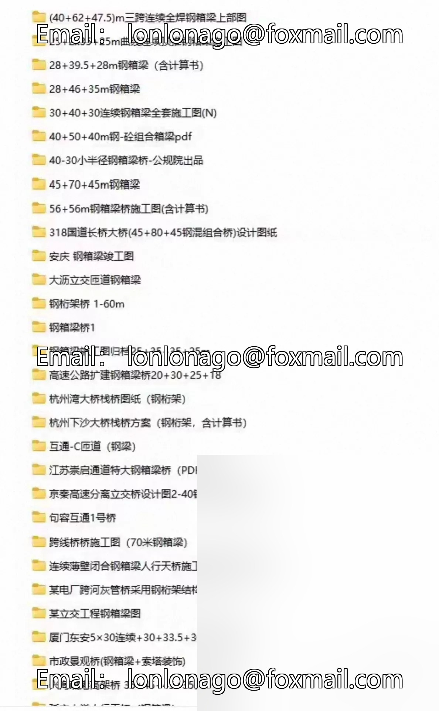

# Bridge construction drawing set - steel box girder and steel truss construction drawing CAD version

## Body

Bridge construction drawing set - steel box beam and steel truss beam construction drawing CAD version

Content covers continuous steel boxgaps with different cross-sectional diameters. Curve top-slide steel box beam Steel truss bridge, Large-span steel-concrete composite beam Steel box girder completion drawing Ramp steel box girders Modified and expanded steel box girders Steel stack bridge Pedestrian bridge …… CAD editable construction drawings Some drawings include design calculation books~

Rich content, suitable for reference in bridge design and construction studies; shipped via Dianpan network.

The construction drawing set covers steel box girders, steel trusses and steel-composite beams for bridges, offering editable CAD construction drawings, design calculation books and rich content suitable for bridge design and construction studies.

<!-- AI_ENRICHED -->

## Images

## Payment

Here is a pay link on Stripe ( https://buy.stripe.com/3cs8yP7sY87d0vu9AB ). Please contact me lonlonago@foxmail.com after funding $89, and I will send you a complete data files , thank you!

